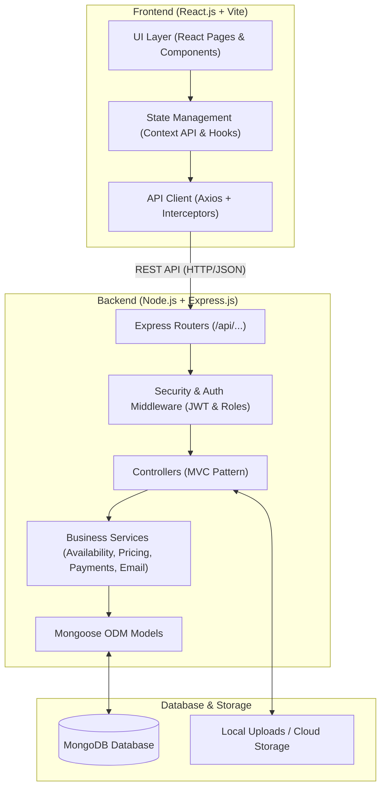

# HotelPro — System Architecture Documentation

## 1. High-Level Architecture Overview

HotelPro is built using a modern **Client-Server Architecture** powered by the **MERN Stack** (MongoDB, Express.js, React.js, Node.js). It separates presentation logic, business services, and persistent data storage into clear boundaries.

---

## 2. Layered Responsibilities

### 2.1 Frontend Layer (`client/`)
- **Framework**: React 18+ with Vite for fast HMR and optimized production bundles.
- **Routing**: `react-router-dom` v6 with client-side route guards (`ProtectedRoute`) distinguishing between Unauthenticated, Customer, Staff, and Admin routes.
- **UI & Styling**: Modern responsive styling combining Tailwind / Bootstrap design principles, modern card layouts, accessible inputs, and polished hospitality typography.
- **Notifications**: `react-toastify` for asynchronous action notifications.
- **Data Visualization**: Interactive charts for revenue, bookings, and occupancy analytics in the Admin & Staff dashboards.

### 2.2 Backend Layer (`server/`)
- **HTTP Server**: Express.js with JSON body parsing, CORS policies, and rate-limiting.
- **MVC Architecture**:
  - `routes/`: Modular REST route endpoints grouped by domain (`auth`, `rooms`, `bookings`, `payments`, `admin`, `staff`).
  - `middleware/`: Authentication (`verifyToken`), Authorization (`requireRole('admin', 'staff')`), input validation, and Multer file upload handling.
  - `controllers/`: Orchestration between HTTP requests/responses and domain services.
  - `services/`: Encapsulated business rules:
    - `availabilityService.js`: Interval-based room reservation scheduling (`[checkIn, checkOut)`).
    - `pricingService.js`: Server-side total price calculations with taxes.
    - `paymentService.js`: Provider-agnostic payment processing (Stripe & Development Adapter).
    - `emailService.js`: Asynchronous transactional emails (booking confirmations, receipts, cancellations).
  - `models/`: Mongoose schemas with indexing, timestamps, and data validation.
  - `utils/`: Centralized response helpers, logging, and seed generators.

### 2.3 Data Layer
- **MongoDB**: Document database with indexed lookups on emails, room numbers, dates, and booking statuses.
- **Embedded vs. Referenced Data**:
  - References (`ObjectId`): Used between Users, Rooms, Bookings, and Payments to prevent unbounded document growth and ensure referential consistency.
  - Embedded snapshots: Stored on Bookings (e.g., room rate at booking time, guest snapshot) to protect historical financial integrity even if room rates change later.

---

## 3. Security Architecture
1. **Password Security**: Passwords salted and hashed with `bcryptjs` (cost factor 10).
2. **Stateless JWT Authentication**: Tokens signed with HS256, carrying user ID and role, verified on all protected API requests.
3. **Role-Based Access Control (RBAC)**:
   - `customer`: Can book rooms, view own bookings, request cancellation, submit reviews.
   - `staff`: Can manage guest check-in/out, update room operational states, process service tickets.
   - `admin`: Full administrative access (create/edit rooms, view revenue reports, manage user roles, oversee all bookings).
4. **Mass Assignment Prevention**: Registration strictly forces the public `customer` role on the server regardless of payload inputs.
5. **Payment Security**: Raw card details or CVVs are never saved on the server; payments rely on provider order/session tokens and webhook signatures.
