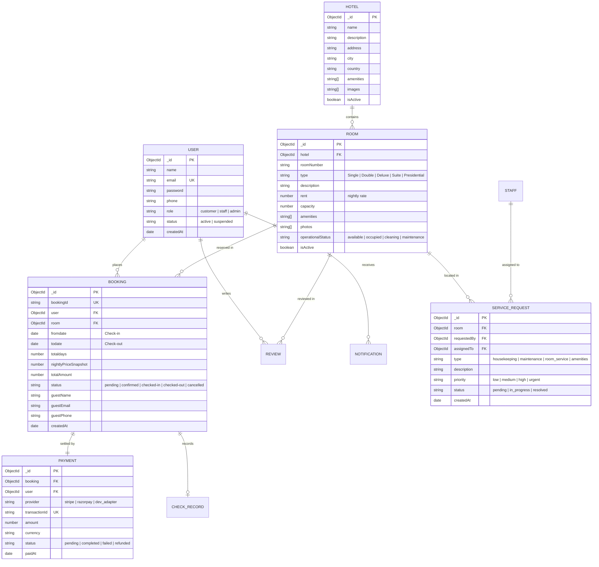

# HotelPro — Database Design & Data Models

## 1. Entity Relationship Overview

The HotelPro database uses MongoDB with Mongoose ODM. Collections are structured according to a normalized model with targeted embedded snapshots for historical auditability (such as prices at the time of booking).

---

## 2. Core Mongoose Schemas

### 2.1 Users Collection (`users`)
- `name` (String, required, trim)
- `email` (String, required, unique, lowercase, trim)
- `password` (String, required, minlength 6)
- `phone` (String, required)
- `role` (String, enum: `['customer', 'staff', 'admin']`, default: `'customer'`)
- `status` (String, enum: `['active', 'suspended']`, default: `'active'`)
- `timestamps`: true

### 2.2 Rooms Collection (`rooms`)
- `hotel`: ObjectId -> `Hotel`
- `roomNumber`: String, required, unique per hotel
- `type`: String, enum: `['Single', 'Double', 'Deluxe', 'Suite', 'Family Suite']`
- `description`: String, required
- `rent`: Number, required (price per night in USD)
- `capacity`: Number, required (default: 2)
- `amenities`: [String] (e.g., `["WiFi", "AC", "TV", "Mini Bar", "Balcony"]`)
- `photos`: [String] (URLs or upload filenames)
- `operationalStatus`: String, enum: `['available', 'occupied', 'cleaning', 'maintenance']`, default: `'available'`
- `isActive`: Boolean, default: true
- `timestamps`: true

### 2.3 Bookings Collection (`bookings`)
- `bookingId`: String, required, unique (e.g., `HP-BK-20261028-1234`)
- `user`: ObjectId -> `User`, required
- `room`: ObjectId -> `Room`, required
- `fromdate`: Date, required (Check-in, 00:00 UTC)
- `todate`: Date, required (Check-out, 00:00 UTC)
- `totaldays`: Number, required
- `nightlyPriceSnapshot`: Number, required
- `totalAmount`: Number, required
- `guestName`: String, required
- `guestEmail`: String, required
- `guestPhone`: String, required
- `status`: String, enum: `['pending', 'confirmed', 'checked-in', 'checked-out', 'cancelled']`, default: `'confirmed'`
- `paymentStatus`: String, enum: `['unpaid', 'paid', 'refunded']`, default: `'paid'`
- `cancellationReason`: String
- `cancelledAt`: Date
- `timestamps`: true

### 2.4 Payments Collection (`payments`)
- `booking`: ObjectId -> `Booking`, required
- `user`: ObjectId -> `User`, required
- `provider`: String, enum: `['stripe', 'razorpay', 'dev_adapter']`, default: `'dev_adapter'`
- `transactionId`: String, required, unique
- `amount`: Number, required
- `currency`: String, default: `'USD'`
- `status`: String, enum: `['pending', 'completed', 'failed', 'refunded']`, default: `'completed'`
- `cardLast4`: String (optional masked display)
- `timestamps`: true

### 2.5 ServiceRequests Collection (`servicerequests`)
- `room`: ObjectId -> `Room`, required
- `requestedBy`: ObjectId -> `User`, required
- `assignedTo`: ObjectId -> `User` (Staff member)
- `type`: String, enum: `['housekeeping', 'maintenance', 'room_service', 'amenities', 'other']`
- `priority`: String, enum: `['low', 'medium', 'high', 'urgent']`, default: `'medium'`
- `description`: String, required
- `status`: String, enum: `['pending', 'in_progress', 'resolved']`, default: `'pending'`
- `notes`: String
- `timestamps`: true

